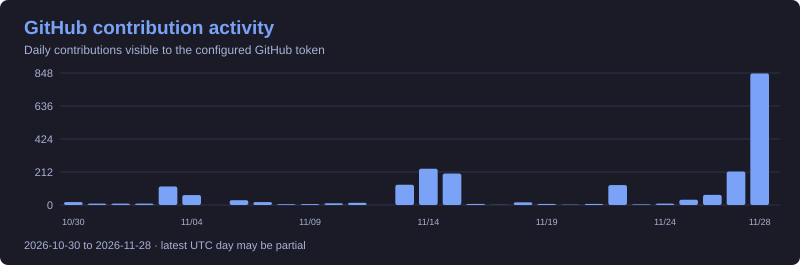
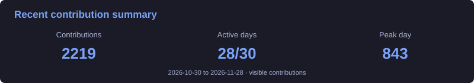

<div align="center">

# Breno Farias

**Computer Science graduate · Master's student · Substitute Professor at [UTFPR](https://www.utfpr.edu.br/)**


[](#coding-activity)
[](https://brenofarias2.wixsite.com/aboutme)

<p align="center">
  <a href="https://www.linkedin.com/in/breno-farias-da-silva/"></a>
  <a href="mailto:breno.vicio78@gmail.com"></a>
  <a href="https://brenofarias2.wixsite.com/aboutme"></a>
</p>

</div>

## About me

My interests include software engineering, machine learning, distributed systems, cybersecurity, and data engineering. I work with Python, C/C++, Java, JavaScript and TypeScript. Outside of work, I enjoy coding, games, music, mathematics and problem-solving.

**Professional and academic profiles:**

- [Professional résumé (Curriculum Vitae)](https://drive.google.com/file/d/1I_iN1nxZ6MeyY64eZYgILngCuTod-4xP/view?usp=sharing) — education, professional experience and projects.
- [Lattes Curriculum](http://lattes.cnpq.br/9056898656400990) — academic profile, research and scientific production.

## Selected projects

### Research, AI & scientific software

- [**DDoS-Detector**](https://github.com/BrenoFariasdaSilva/DDoS-Detector) — Machine learning framework for DDoS detection, with feature selection, WGAN-GP data augmentation and ensemble classifiers.
- [**Worked-Example-Miner**](https://github.com/BrenoFariasdaSilva/Worked-Example-Miner) — Research tool for analyzing Java repositories and mining worked examples.
- [**Recommendation-Systems-AI**](https://github.com/BrenoFariasdaSilva/Recommendation-Systems-AI) — Recommender-system experiments and AI implementations in Jupyter notebooks.
- [**LaTeX-Reviewer**](https://github.com/BrenoFariasdaSilva/LaTeX-Reviewer) — Automated academic LaTeX proofreading, style checks and deterministic corrections.

### Software engineering & security

- [**E-Commerces-WebScraper**](https://github.com/BrenoFariasdaSilva/E-Commerces-WebScraper) — Python web scraping project for multiple e-commerce platforms, including Amazon, AliExpress and Mercado Livre.
- [**TextSync**](https://github.com/BrenoFariasdaSilva/TextSync) — Real-time distributed text editor built with React, Node.js, MongoDB and WebSockets.
- [**Authy-iOS-MiTM**](https://github.com/BrenoFariasdaSilva/Authy-iOS-MiTM) — Authenticator migration utility (fork of [AlexTech01/Authy-iOS-MiTM](https://github.com/AlexTech01/Authy-iOS-MiTM)).
- [**Multi-AI-API-Response-Collector**](https://github.com/BrenoFariasdaSilva/Multi-AI-API-Response-Collector) — Python tool for collecting and comparing responses from multiple AI APIs.

### Developer tools & data engineering

- [**GitHub Contribution Analytics**](https://github.com/BrenoFariasdaSilva/GitHub-Contribution-Analytics) — Local-first Streamlit dashboard for Git contributions, code churn, source lines of code and repository history.
- [**GitHub-Activity-Reports-Generator**](https://github.com/BrenoFariasdaSilva/GitHub-Activity-Reports-Generator) — Multi-repository GitHub activity reports with per-author Quarto, PDF and DOCX exports.
- [**GitHub-Forks-Tracker**](https://github.com/BrenoFariasdaSilva/GitHub-Forks-Tracker) — CLI for analyzing GitHub forks and divergent commits, with CSV exports.
- [**Datasets-Features-Compatibility**](https://github.com/BrenoFariasdaSilva/Datasets-Features-Compatibility) — Toolkit for inspecting and comparing tabular datasets and their feature compatibility.
- [**Multi-Format-Dataset-Converter**](https://github.com/BrenoFariasdaSilva/Multi-Format-Dataset-Converter) — Recursive dataset cleaning and conversion across ARFF, CSV, Parquet and TXT.

[View all public repositories](https://github.com/BrenoFariasdaSilva?tab=repositories&sort=stargazers)

## Technical stack

### Programming, scripting & markup

<p align="left">
  
  
  
  
  
  
  
  
  
  
  
  
</p>

### AI, machine learning & data

<p align="left">
  
  
  
  
  
  
  
</p>

### Databases

<p align="left">
  
  
  
</p>

### Frameworks, libraries & messaging

<p align="left">
  
  
  
  
  
  
</p>

### DevOps, version control & infrastructure

<p align="left">
  
  
  
  
  
</p>

### Development environments

<p align="left">
  
  
  
  
  
  
</p>

### Operating systems

<p align="left">
  
  
  
  
  
  
  
  
  
</p>

## GitHub statistics

<p align="center">
  
  
</p>
<p align="center">
  
</p>

### Contribution activity

<p align="center">
  <a href="https://github.com/BrenoFariasdaSilva?tab=overview"></a>
</p>
<p align="center">
  
</p>

<details>
<summary>Contribution snake animation</summary>

<picture>
  <source media="(prefers-color-scheme: dark)" srcset="https://raw.githubusercontent.com/BrenoFariasdaSilva/BrenoFariasdaSilva/output/github-contribution-grid-snake-dark.svg">
  
</picture>

</details>

### GitHub trophies

<p align="center">
  <a href="https://github.com/ryo-ma/github-profile-trophy" title="GitHub profile trophies"></a>
</p>

## Coding Activity

All-time WakaTime data; the table shows selected languages and the percentages refer to the complete tracked time.

<!--START_SECTION:waka-->

```text
From: 09 July 2021 - To: 27 November 2026

Total Time: 4,318 hrs 42 mins

Python                             2,446 hrs 44 mins     ██████████████░░░░░░░░░░░   55.50 %
Bash                               476 hrs 19 mins       ██▓░░░░░░░░░░░░░░░░░░░░░░   10.80 %
C                                  244 hrs 54 mins       █▒░░░░░░░░░░░░░░░░░░░░░░░   05.56 %
Markdown                           241 hrs 20 mins       █▒░░░░░░░░░░░░░░░░░░░░░░░   05.47 %
Java                               154 hrs 39 mins       █░░░░░░░░░░░░░░░░░░░░░░░░   03.51 %
TypeScript                         126 hrs 23 mins       ▓░░░░░░░░░░░░░░░░░░░░░░░░   02.87 %
Text                               126 hrs 12 mins       ▓░░░░░░░░░░░░░░░░░░░░░░░░   02.86 %
Other                              89 hrs 59 mins        ▓░░░░░░░░░░░░░░░░░░░░░░░░   02.04 %
```

<!--END_SECTION:waka-->

## Recent public GitHub activity

<!--START_SECTION:activity-->
1. 🚀 Published release [DDoS-Detector v77 - StackingCacheAndCombinationLogging](https://github.com/BrenoFariasdaSilva/DDoS-Detector/releases/tag/v77-fix-StackingCacheAndCombinationLogging) in [BrenoFariasdaSilva/DDoS-Detector](https://github.com/BrenoFariasdaSilva/DDoS-Detector)
<!--END_SECTION:activity-->

## LeetCode

<div align="center">

[](https://leetcode.com/u/BrenoFariasDaSilva/)

</div>

## Spoken languages

| Flag | Language |
| :---: | :--- |
|  | **American English** |
|  | **Brazilian Portuguese** |
|  | **European Portuguese** |
|  | **Spanish** |

## Social networks

<p align="left">
  <a href="https://www.instagram.com/brenofariasds/"></a>
  <a href="https://twitter.com/BrenoFariasUser"></a>
  <a href="https://www.youtube.com/@BrenoFariasUser/featured"></a>
  <a href="https://www.twitch.tv/brenovicio1"></a>
  <a href="https://wa.me/5563999526402"></a>
</p>
